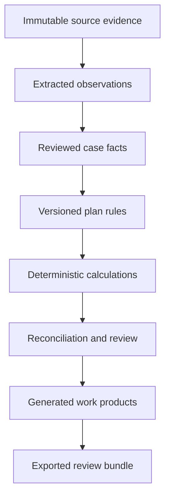
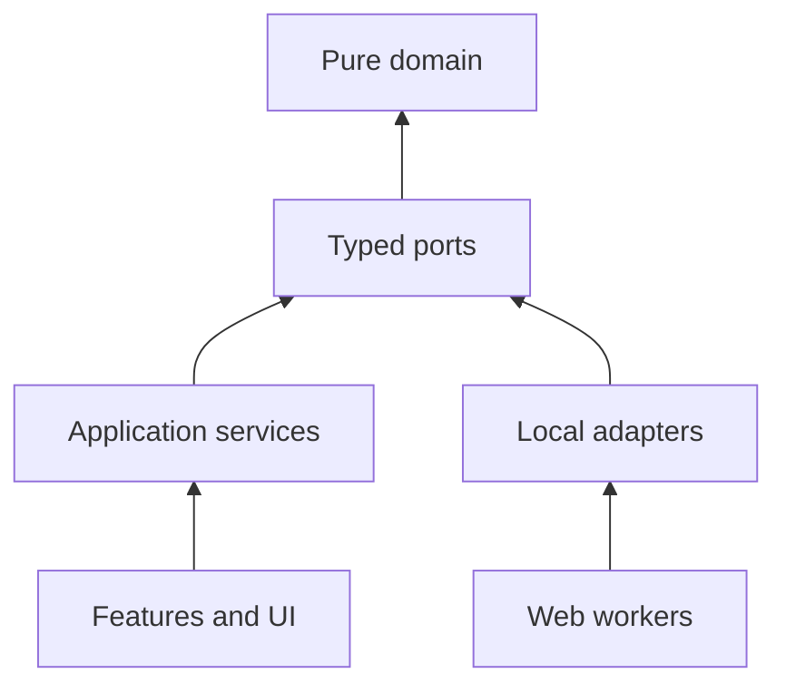

# Architecture

Status: governing technical design  
Audience: developer, actuarial reviewer, and coding agents

## 1. System intent

PBGC Case Workbench is a single-user, local-first browser application that turns heterogeneous case evidence into reviewable facts, calculations, reconciliations, and work products. It is not a generic document chat application and not an autonomous adjudicator.

The deployment target is one generated HTML file plus optional local companion assets for large OCR models, WASM, templates, fonts, and reference tables. There is no required backend, account system, or multi-user synchronization service.

## 2. Architectural drivers

The design optimizes, in order, for:

1. correctness and traceability;
2. local handling of PII;
3. reproducibility across case snapshots;
4. reviewer comprehension;
5. incremental replacement and reuse of existing modules;
6. a simple deployment footprint;
7. developer velocity.

## 3. Bounded workflow



Each arrow is a typed transformation with an audit event. A later stage may link backward but must not mutate an earlier source record.

## 4. Context boundaries

| Boundary | Owns | Must not own |
|---|---|---|
| Evidence | source files, hashes, page/sheet coordinates, OCR text, extraction candidates | interpreted plan rules or benefit amounts |
| Field catalog | canonical field identifiers, types, categories, allowed values, mappings | case values |
| Case facts | reviewed participant/plan values and their provenance | calculation formulas |
| Plan rules | effective-dated plan provisions and interpretation status | UI state or document bytes |
| State model | participant administrative states and dated transitions | benefit formulas that do not represent transitions |
| Actuarial calculations | pure formulas, assumptions, units, intermediate values | parsing, persistence, presentation |
| Work products | typed output models and render instructions | canonical facts or mutable reviewer state |
| Audit | append-only events, versions, supersession links | hidden operational data |

Multiple-decrement mathematics can be one useful technique within the state-model and actuarial contexts—for competing exits such as retirement, disability, death, or termination. It is not the architecture for the entire operation: evidence interpretation, statutory guarantees, plan provisions, priorities, asset allocation, appeals, and document production need distinct models.

## 5. Dependency architecture



Rules:

- `src/domain/**` imports only domain/shared code.
- `src/app/**` orchestrates use cases and transactions; it contains no formulas.
- `src/adapters/**` implements ports for documents, storage, workbooks, and exports.
- `src/workers/**` isolates CPU-heavy OCR, hashing, PDF parsing, and workbook parsing.
- `src/features/**` owns screen-level behavior and view models.
- `src/ui/**` contains reusable presentational components and design tokens.

## 6. Canonical record model

The case is a graph of immutable/versioned records rather than one mutable mega-object.

| Record | Minimum identity and controls |
|---|---|
| `SourceArtifact` | ID, SHA-256, media type, original name, byte size, import timestamp |
| `EvidenceLocator` | artifact ID, page/sheet/range/span, normalized excerpt hash |
| `Observation` | field ID, raw value, normalized candidate, method, confidence, locator |
| `ReviewedFact` | value, units, provenance IDs, review status, reviewer note, supersedes |
| `PlanRule` | rule ID, rule kind, parameters/expression, authority, effective interval, status |
| `AssumptionSet` | mortality, interest, timing, rounding, version, approval status |
| `CalculationRun` | input snapshot, rule versions, engine version, outputs, trace, warnings |
| `Reconciliation` | populations/totals compared, tolerance, differences, disposition |
| `WorkProduct` | type, source snapshot, template version, renderer version, file hash |
| `AuditEvent` | event type, time, actor, component, record references, before/after hashes |

Every exported work product points to a frozen case snapshot and calculation run. Recalculation creates a new run.

## 7. Field catalog and supplied data dictionary

The supplied macro-enabled workbook is retained unchanged at `references/data-dictionary/data_dictionary_complete.xlsm`. It currently contains three sheets and a primary catalog with columns for table name, field name, description, type, size, field category, and pipe-separated categories.

It is a reference source, not a runtime database. A deterministic build script should eventually derive a normalized, reviewed JSON catalog with:

- stable `fieldId` independent of display labels;
- source workbook hash and source cell coordinates;
- canonical type and units;
- privacy classification;
- validation constraints and enumerations;
- legacy aliases and output mappings;
- deprecation/supersession metadata.

Derived catalogs are reviewed and versioned. The workbook remains immutable.

## 8. State and multiple-decrement model

Represent administrative/participant status as a dated event stream projected into state. A transition contains `from`, `to`, effective date, cause, source evidence, and rule version. Invalid transitions fail validation.

For actuarial projections, a competing-risk model may define decrements \(q_x^{(j)}\) for cause \(j\), with a declared timing assumption and relationship between associated single-decrement and multiple-decrement rates. Never infer independence or uniform distribution of decrements silently. The model must expose:

- state space and absorbing states;
- decrement causes and age/time basis;
- conversion method and timing assumption;
- table/version provenance;
- reconciliation that total decrement probability is valid;
- boundary tests and independently computed examples.

The operational state machine and actuarial decrement model share identifiers but remain separate components.

## 9. Calculation contract

Every material calculation returns a structured envelope:

```ts
type CalculationResult<T> = {
  value: T;
  units: string;
  inputs: Array<{ id: string; value: unknown; units?: string; provenanceIds: string[] }>;
  ruleIds: string[];
  assumptionSetId?: string;
  formula: string;
  intermediates: Record<string, number | string>;
  rounding: Array<{ stage: string; mode: string; digits: number }>;
  warnings: string[];
  engineVersion: string;
};
```

No constant may appear in production code without a named rule/assumption record or a mathematical identity. Dates use explicit local calendar dates and inclusive/exclusive boundary rules. Money uses decimal arithmetic or scaled integers; binary floating point is not a storage representation for final currency.

## 10. Persistence and files

Use an adapter interface so the storage implementation can change:

- IndexedDB for active case objects and indexes;
- Origin Private File System or File System Access API for large local artifacts when available;
- encrypted export bundle for portability/backup;
- JSON manifest with content hashes for integrity;
- explicit schema migrations with pre-migration backup.

Never depend on browser storage as the only durable copy. The application shows backup age and schema version. Cache and local-storage convenience state are distinct from the case record.

## 11. Import pipeline

1. Read bytes locally and compute SHA-256 before parsing.
2. Detect duplicates by hash and record the import decision.
3. Parse PDF, spreadsheet, text, image, or OOXML in a worker.
4. Preserve raw output as an immutable derivative linked to the source.
5. Run PII classification and extraction candidate generation locally.
6. Present candidates with source context for review.
7. Promote accepted candidates to reviewed facts; rejected candidates remain auditable.

OCR confidence is not correctness. Regex matches are not identity proof. PII detection must be context-sensitive and include a manual review surface.

## 12. Work-product pipeline

Support work products through typed renderers, not UI scraping. Initial output families are Plan Summary/R5, Plan Factors, DEL, §436 materials, estimated administration, estimated adjustment, V1 inputs/summary, valuation listings, BSRS configuration, and case memo.

Each renderer:

- declares required facts/rules/calculations;
- blocks or visibly marks missing/assumed values;
- writes to a copy of a versioned template;
- preserves formula cells and formatting through fixture tests;
- records template and output hashes;
- emits a machine-readable companion manifest.

## 13. Module-reuse strategy

Do not merge previous applications wholesale. Extract routines behind ports after a salvage review.

| Candidate source | Reuse target | Required condition |
|---|---|---|
| Bulk OCR Studio | browser OCR workers, local parsing, PII-review UX, IndexedDB/export patterns | isolate OCR engine; add provenance and adversarial tests |
| R5 / Plan Summary module | R5 normalization, field mappings, metadata, OOXML filling | treat extraction as a separate port; validate every mapping |
| PII Detector module | context-aware detectors, custom rules, review/redaction/export gates | benchmark false positives/negatives on synthetic corpus |
| Form 5500 module | schedule routing and field mappings | contract-test against authoritative samples |
| Plan Factors module | schema checks, OOXML patches, formula insertion | re-author or independently verify all plan rules |
| Actuarial Mathematics module | interest/life-table/commutation primitives and traces | property tests, units, precision, and table provenance |
| Mock Population module | deterministic synthetic fixtures | ensure values cannot be mistaken for real identities |
| Internal Indicators module | non-empty detection, indicator selection, formula remap | workbook-version compatibility tests |
| Personal DB module | local archive/vault/lease patterns | threat model and migration tests |
| V1 Engine Explorer | VBA summary-export behavior | do not treat stub JavaScript analyzers as implemented |

Unsafe legacy shortcuts—hard-coded benefit percentages, fixed PV multipliers, generic elapsed-millisecond age calculations, or secondary-source rate scrapers—are reference clues only and must not enter production calculations.

## 14. Security and privacy model

Threats include accidental repository commits, prompt/MCP disclosure, stale exports, malicious documents, formula injection, browser-extension access, and dependency compromise.

Controls:

- `cases/**`, exports, temporary OCR, browser profiles, and secrets are ignored by Git;
- OpenCode sharing is disabled;
- external MCPs are disabled by default and restricted to public/synthetic engineering work;
- imports receive size/type limits and parse in workers;
- exported CSV/XLSX text is protected from formula injection;
- no dynamic evaluation of plan formulas; use a typed expression grammar or code-reviewed functions;
- dependencies and vendored assets have hashes, licenses, and versions;
- content-security policy for the packaged build allows only local resources;
- logs use opaque IDs and structured redaction.

## 15. Testing strategy

| Layer | Purpose |
|---|---|
| Unit | pure math, calendar rules, normalization, state transitions |
| Property | monotonicity, probability bounds, commutation identities, round-trip invariants |
| Contract | parser, storage, OCR, workbook, and export adapters |
| Integration | evidence-to-fact-to-calculation-to-work-product slices |
| Regression | golden JSON/workbook/document outputs and legacy comparisons |
| Accessibility | semantics, keyboard flow, focus, contrast, reduced motion |
| Security | hostile files, formula injection, archive traversal, oversized inputs |

A golden output is not automatically correct; its independent review record is part of the fixture metadata.

## 16. Deployment and offline operation

Vite produces a single-file build with inlined application code and styles. Large assets are copied beside it under a versioned `assets/` directory and referenced by relative URL. Maintain `assets-manifest.json` with SHA-256, license, purpose, and expected size.

The application must start from a small local HTTP server for predictable worker, module, and file behavior. `file://` execution is not a supported production contract. The bundle requires no network after assets are installed.

## 17. Architecture decisions to record next

Create ADRs before selecting:

- exact decimal arithmetic representation;
- IndexedDB vs OPFS allocation and export format;
- typed plan-rule expression strategy;
- OCR/PDF/XLSX engines and local asset licensing;
- workbook rendering approach;
- encryption and key-handling for portable bundles;
- authoritative table update and validation process.

