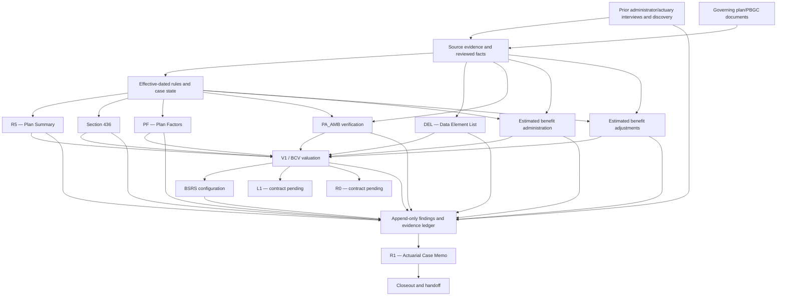

# Physics Paradigm + typed-effects architecture for the PBGC Case Workbench

Status: **proposed governing design; incremental implementation underway** (2026-11-13).
Scope: the **entire** case lifecycle, not a PA_AMB-only feature.
Companion: [R1 contribution contract](../work-products/r1-contribution-contract.md).

## 1. End state and workflow

The intended final technical work product is the **R1 Actuarial Case Memo**. R1 is not the same as an intake/data request. Previous products remain independent official work products; they also publish structured facts, calculations, findings, and evidence for R1 assembly.

The supplied architecture sketches depict these responsibilities:

1. **Source / discovery** — plan corpus; prior plan administrator and prior actuary interviews; unanswered questions; review of plan documents and case-specific data.
2. **Structuring** — versioned case facts, plan history, population/census, governing rules, authoritative dictionary fields, reusable citations, approved assumptions, and work-product contracts.
3. **Upfront actuarial work** — R5 Plan Summary, DEL Data Element List, §436 analysis, PF Plan Factors, PA_AMB acceptance analysis, estimated benefit administration, estimated benefit adjustments.
4. **Determination / valuation** — BET where applicable, V1/BCV, and BSRS configuration and benefit-statement support.
5. **Review and publication** — interpretations, exceptions, consultations, human approvals, and evidence-backed findings from **every** work-product module.
6. **Final case products** — R1 Actuarial Case Memo, subsequent R0/L1 artifacts when their exact official meaning is established, and software/case closeout.

R5, DEL, and PF names in this architecture mean **Plan Summary**, **Data Element List**, and **Plan Factors**. They must not be silently redefined as a notice, a determination letter, or a generic plan financial report. The current registry uses such labels in places; migration requires review of the templates, callers, and tests. Do not rename stable IDs without an explicit migration.

R0, L1, and BET appear in the user-provided diagram. Their applicable template, work-product identity, and mandatory data dependencies must be verified before they are registered as implemented or given a calculation policy.

The objective is **R1-centered, not R1-only**: each upstream product must remain valid, complete, reviewable, and exportable on its own.

## 2. The Physics Paradigm

Model the case as a versioned state and each material operation as an explicit transition:

```text
S(t+1) = T(S(t), event(t), governingRules(t))
```

At each step preserve these laws:

- **State**: reviewed facts, source artifacts, plan versions, participant history, rule versions, assumptions, calculation runs, findings, approvals, templates, product readiness, and audit history are explicit.
- **Transformation**: imports, corrections, calculations, approvals, R1 publication and exports have named input/output contracts.
- **Invariants**: sources never change in place; money and dates are typed; missing is not zero; unsupported calculations remain blocked; every material finding retains its evidence.
- **Time**: source observation date, plan effective date, participant event date, valuation date, approval date and export time are separate.
- **Side effects**: UI, disk, OCR, API and document rendering stay outside pure domain computation.
- **Symmetry**: all products publish the same contribution envelope; work-product-specific logic is expressed through data and rules, not separate ad hoc pipelines.

A product is recalculated from a frozen snapshot. It must never edit an earlier snapshot retroactively. A source correction adds a new version and marks the dependent calculations/findings **stale** until replayed and reviewed.

## 3. Shared primitive effects

Use functional design patterns only when they decrease complexity. An object named *Monad* does not become a mathematical monad without valid unit/bind laws.

| Effect | Operational responsibility |
|---|---|
| `Reader<Context,A>` | Read immutable case, rule, template and date context |
| `Result<A,Error>` | Return a value or a blocking error; no silent fallback |
| `Option<A>` | Represent absent values; missing evidence remains unknown |
| `Writer<A,Trace>` | Accumulate calculation trace, references, warnings and proposed findings |
| `State<State,A>` | Represent a pure transition to a new versioned state |
| `Scenario<A>` | Explore labeled alternative assumptions; a collection effect, not necessarily its own monad |

Use `Reader/Result/Writer` as a convenient **typed effect composition**. Avoid a general-purpose monad-transformer framework if plain TypeScript discriminated unions, functions and immutable records are clearer.

An approved finding is never a side effect of a calculation: approval is a separate authorized transition.

## 4. Shared composite workflows

| Workflow | Consumes | Publishes |
|---|---|---|
| `SourceFlow` | Files, interviews, questions | Immutable sources, locators, observations, unresolved items |
| `RuleFlow` | Reviewed sources, effective dates | Versioned, reviewable plan/PBGC rules |
| `CalculationFlow` | Facts, rules, assumptions, date | Typed values, intermediates, reproducible traces |
| `VerificationFlow` | Results, validation predicates, comparisons | Discrepancies, exceptions, reconciliation records |
| `DecisionFlow` | Evidence, proposed interpretations | Explicit review decisions and approvals |
| `PublicationFlow` | Reviewed calculations and decisions | Structured work-product contributions, provenance and dependencies |
| `AssemblyFlow` | Contributions, template manifest | R1 section plan and document only after all applicable gates pass |

A work-product runner composes selected workflows; it does not implement all effects again.

## 5. Dependency graph



The arrows express **candidate data dependencies**, not proof that each is mandatory for every plan. A product's actual dependency policy is determined by its reviewed work-product contract and the facts of the case. BET and other case-dependent workflows must be included when applicable after their source contracts are confirmed.

R1 drafts may exist before all dependencies are final. **Approved final R1 publication** must reconcile to current approved upstream findings, even when the originating work product is not an input to V1.

## 6. One reusable contribution envelope

Each work-product calculation or review may publish:

```text
WorkProductContribution = (
  identity,
  caseId,
  sourceWorkProductId and version,
  frozen source snapshot,
  finding category and narrative,
  structured evidence pointers,
  effective-dated rule/assumption dependencies,
  target R1 template sections and presentation roles,
  human approval state and audit record
)
```

Use `src/domain/work-products/contributions.ts` as the initial, pure TypeScript contract.

- Source locations may be PDF pages, Word sections, spreadsheet cells/ranges, CSV rows, or reviewed text spans.
- A reference claiming to be from Image Viewer **must contain an actual verified document number**; do not infer one from a filename, GUID, or raw document hash.
- An R1 assembler receives the **template-defined** section identifiers. The domain must not invent the list of sections.
- Publication is blocked for draft/unapproved findings, stale snapshots, stale rule dependencies, missing citations, and unknown template sections.
- Superseded findings remain part of history but do not enter current final output.
- No private participant evidence or real case data is sent to GitHub or an external model.

The ledger is a **structured evidence graph**, not a text scrapbook. Each sentence and numeric assertion must retain enough source and calculation identity for an actuary to inspect its origin.

## 7. R1 section routing

The official R1 template and its reviewed manifest control **where** a contribution is inserted. Do not assume all cases have exactly the same required paragraphs.

Examples established by the Actuarial Case Memo instructions and sample language:

| R1 section | Candidate contributions |
|---|---|
| Front-page valuation tables | Approved V1/BCV values and reconciled valuation totals |
| 1. Relevant Dates | Case intake, plan termination records, interviews |
| 2. Participant Count Reconciliation | PDR / population / V1 reconciliation |
| 3. Data Issues | Census quality, missing data, PA_AMB acceptance findings, corrections |
| 4. Plan Documents | R5 and referenced plan amendments, effective dates |
| 5. Plan Benefit Formula Summary | R5/PF plan rules, formula history |
| 6–10. Retirement, Vesting, Survivor, Offsets, Forms | Reviewed plan provisions, PF, V1 and special case interpretations |
| 11. Interpretations of Note | Human-approved interpretations, conflicts and their supporting records |
| 13–18. Limitations and Allocation | Authorized V1/BCV, §436 context where relevant, valuations, limitations and asset allocation |
| 19–23. Benefit Changes / Estimated Benefits / Post-NRD | Estimated administration, estimated adjustments, V1, payment/benefit reconciliation |
| 24. QDROs | Reviewed QDRO evidence and valuation treatments |
| 25. BSRS | Reviewed BSRS status, benefit statement populations and outstanding issues |
| 26. Additional Comments | Material findings not accommodated elsewhere |
| 27–29. Expense / Ages / Valuation Rates | Reconciled valuation inputs and outputs |

This is a **routing aid**, not permission to assert missing facts or replace official wording. All actual R1 section labels and placeholders must come from the exact approved R1 template. Preserve that template's layout.

## 8. Runtime vs proposed capabilities

Verified from the existing repository README and work-product registry on 2026-11-13:

- The application is a **pilot**, not an independently validated PBGC benefit-determination system.
- A synthetic end-to-end workflow, evidence intake and review, partial R5 plan data handling, a population register, and selected rule utilities are implemented.
- Work products such as DEL, §436, PF, AMB, estimated benefit administration/adjustment, V1 valuation, BSRS, final actuarial case memo and closeout remain blocked.
- The new contributions model and tests are an **architectural vertical slice only**; they do not constitute a working final R1 renderer, repository-wide state migration, or a completed product.

Do not mark blocked products implemented until the required source rules, output templates, calculation tests, validation, approvals and fully offline end-to-end tests are complete.

## 9. Migration and acceptance sequence

1. **Correct the semantic registry.** Review official R5, DEL, PF and R1 templates and migrate mislabeled entries without breaking saved cases. The existing `wp.r1-data-request` is **not** the final R1 memo. Retain/mark it legacy until usage and migration are determined.
2. **Publish ledger contracts.** Validate source artifact identity, location, Image Viewer number, section targets, reviewer approval, snapshot and rule versions.
3. **Persist the ledger.** Add append-only storage, export/restore and forward-compatible schema migration. Test lossless round trips.
4. **Connect one thin upstream slice.** Publish a synthetic PA_AMB finding, approve it, route to R1 sections 3/11 and confirm citations. Then extend to R5, DEL, §436 and PF.
5. **Build the dependency DAG.** Revisions cause dependent products and findings to become stale. No stale R1 contributions are silently reused.
6. **Transcribe the R1 template.** Identify approved section IDs, tables, paragraphs, placeholders and required citations. Produce a copy, not a new layout.
7. **Build the R1 constructor.** Assemble a draft with explicit unresolved items; release a final output only after all applicable checks and human approval.
8. **Extend to all work products.** EAdm, EAdj, BET, V1, BSRS, L1, R0 and closeout as supported by governing documents.
9. **Test the complete office contract.** No network, server or installation; synthetic data only for CI; single-file `file://` deployment, provenance inspection, export/restore, and full case replay.

**Acceptance invariants**

- Changing an input source, plan rule, calculation or approved finding invalidates all affected downstream output snapshots.
- An unapproved finding cannot silently enter a final R1.
- Every Image Viewer citation in a generated memo contains a verified document number.
- R1 narrative refers to the approved upstream determination, not an independent LLM reinterpretation.
- A source link, page/sheet locator and calculation trace remain inspectable after export and restore.
- All R1-dependent findings are versioned, deduplicated, and routed by the reviewed template manifest.

## 10. Responsibilities

The LLM or code agent may help ingest, classify, summarize, draft and explain. It must not replace typed facts, rules, evidence, deterministic calculations, independent validation, or human approval.

No new mandatory backend, external API or telemetry is authorized. Keep the existing single-file offline deployment constraint.
